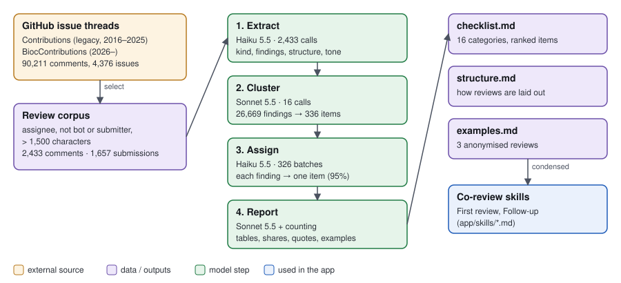
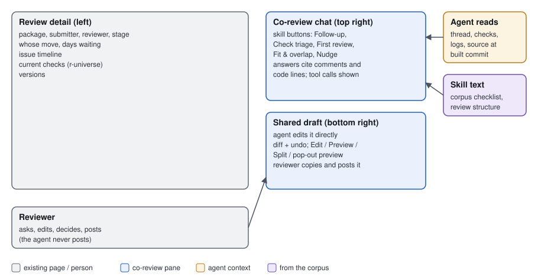

# What ten years of Bioconductor reviews tell a co-review agent

November 2026 · bioc-contrib-intelligence

Bioconductor has reviewed package submissions in public GitHub issues since 2016, first on
`Bioconductor/Contributions` and, since 2026, on `Bioconductor/BiocContributions`. Every one of
those reviews is still there. When I started building an agent to help reviewers draft their
comments, I wanted it to look for what reviewers look for, and to write the way they write, rather
than follow a checklist I made up. So before tuning any prompts, I read the reviews, or rather had
models read all of them, and counted what came back.

This note describes that corpus, how it was processed, what it cost, what it found, and how the
results feed the co-review pane in the reviewer app. Everything here comes from public GitHub data.

## The reviewer app and the co-review pane

The reviewer app (<https://reviewer.bioconductor.org>) shows each Bioconductor reviewer
their open assignments: whose move it is, how long it has been waiting, what changed since their
last comment, and the current r-universe check results. Each submission's detail page now has a
co-review pane on the right. At the top is a chat with an agent; at the bottom is a draft of the
reviewer's next comment, which both the reviewer and the agent can edit. The agent reads the issue
thread, the current checks and their logs, and the package source at the exact commit r-universe
built. It cites code as links to specific lines. It never posts anything. The reviewer edits the
draft, copies it, and posts it under their own name, with a fixed line saying it was drafted with AI
assistance.

The pane has "skills", which are standard tasks a reviewer can start with one click: First review,
Follow-up, Check triage, Fit & overlap, and Nudge. The corpus work described below is what the First
review and Follow-up skills are built on.

## The corpus

From both trackers I took every comment written by one of the issue's assigned reviewers, excluding
bots and the submitter, and longer than 1,500 characters. The length cut keeps real reviews and drops
short exchanges ("thanks, will look this week").

| | Legacy (`Contributions`) | New (`BiocContributions`) | Total |
|---|---:|---:|---:|
| Review comments | 2,313 | 120 | 2,433 |
| First full reviews (as classified) | 1,307 | 101 | 1,408 |
| Submissions with at least one | | | 1,657 |
| Reviewers | | | 29 |

**Table 1.** The review corpus. All comments on both trackers number 90,211 across 4,376 issues;
the corpus is the assigned reviewers' long comments. "First full review" is the extraction model's
label; the other comments are follow-ups (656) or other (369).

## Processing

**Figure 1.** The distillation pipeline. Each stage caches its results, so a rerun only pays for
what is missing. Code: `experiments/reviews/distil.py`.

There are four stages. In **extract**, a small model (Claude Haiku 5.5) reads each comment once and
returns its kind (first review, follow-up, other), every individual request the reviewer made with
a category and a short verbatim quote, and notes on structure and tone. That produced 26,669
findings, about 11 per comment. In **cluster**, a larger model (Claude Sonnet 5.5) takes the findings
for each of 16 categories (vignette, DESCRIPTION, coding practice, S4 classes, unit tests and so on)
and writes a list of distinct checklist items: 336 in all. In **assign**, Haiku goes back over the
findings in batches of 80 and labels each with the checklist item it is an instance of; 95% matched
an item and the rest are reported as unmatched. **Report** is mostly arithmetic: counts, the share
of first reviews raising each item, split by tracker, and quotes picked from different reviewers.
Sonnet writes only the prose in the structure notes. Three example reviews were picked by hand from
candidates (a first review and follow-ups by the same reviewer, broad coverage, different reviewers)
and anonymised: logins become role labels, package names stay.

One thing went wrong and is worth recording. The first assign run failed on 88% of batches: Haiku
returned empty answers because its hidden reasoning used up the 2,000-token output limit. Raising the
limit to 8,000 and rerunning only the failed batches fixed it with no errors. The cost of the failed
attempt is included below.

| Model | Calls | Tokens in | Tokens out | Cost (USD) |
|---|---:|---:|---:|---:|
| Claude Haiku 5.5 | 3,077 | 8,515,599 | 5,016,063 | 3.36 |
| Claude Sonnet 5.5 | 18 | 456,228 | 34,028 | 1.25 |
| **Total** | **3,095** | **8,971,827** | **5,050,091** | **4.61** |

**Table 2.** Cost of processing the corpus, 14 November 2026. Costs are the per-request costs
recorded by Cloudflare AI Gateway, summed, not estimates from list prices. Wall time was 50 minutes
from the first call to the last (39 minutes of logged stage time, 8 concurrent requests).

## What reviewers ask for

| Category | Share of first reviews | New tracker | Legacy |
|---|---:|---:|---:|
| Vignette | 84% | 87% | 84% |
| Coding practice | 76% | 72% | 76% |
| Code style | 66% | 53% | 67% |
| DESCRIPTION | 64% | 63% | 64% |
| Man pages and examples | 60% | 54% | 61% |
| Reuse of Bioconductor classes | 50% | 55% | 50% |
| NAMESPACE | 42% | 38% | 42% |
| Unit tests | 41% | 44% | 41% |
| Data / ExperimentHub | 31% | 33% | 30% |
| Dependencies | 26% | 36% | 25% |
| BiocCheck | 15% | 24% | 14% |
| Fit and overlap | 17% | 22% | 16% |

**Table 3.** Share of first reviews that raise at least one item in each category (selected
categories). New-tracker shares rest on 101 first reviews, so differences under about 10 points are
noise.

The vignette is the most reviewed part of a package. The single most common request is a proper
installation section using `BiocManager::install()` (33% of first reviews), followed by evaluating
vignette code instead of `eval=FALSE` (24%) and writing the vignette as a narrative that explains each
step (20%). In code, the top requests are `seq_len()`/`seq_along()` instead of `1:n` (25%),
vectorising loops (20%), validating arguments in exported functions (19%), `message()`/`warning()`
instead of `cat()`/`print()` (18%) and `vapply()` instead of `sapply()` (16%). The full ranked list,
with typical wording quoted from real reviews, is in `experiments/reviews/out/checklist.md`.

How reviews are written is as consistent as what they ask for. A first review opens with thanks,
groups findings under headings that follow the Bioconductor review template, and closes by asking
the submitter to respond point by point and bump the version. The median first review has 13
findings in about 3,000 to 3,400 characters. Checkbox lists are now the norm: 73% of first reviews on
the new tracker use them, against 47% on the legacy tracker. On the new tracker reviewers also ask
more often for an introduction that places the package among similar tools (38% against 15%) and for
a narrative vignette (34% against 19%). With 101 new-tracker reviews I would treat those as
directions, not measurements.

## How the results reach the review pane

**Figure 2.** The Review detail page with the co-review pane. The agent reads the issue and the
package; the skill text carries what the corpus says reviewers look for and how reviews are laid out.

Skills are short markdown files in the app (`app/skills/`). The First review skill contains the
house structure from the corpus (template headings, one checkbox per finding, required versus
suggested, about 13 findings) and a condensed checklist: the five most common items in each
category with the share of first reviews that raise them, about 13 KB in all. The Follow-up skill
gets the follow-up conventions: thanks, a one-line verdict on progress, then the earlier requests
marked resolved or still open, checked against the new code rather than taken on the submitter's
word.

The checklist tells the agent where to look, not what to say. The skill says explicitly that a point
goes in the draft only if the agent checked it in the source or the logs. In practice the agent
searches the code for the patterns reviewers usually flag, reads the files involved, pulls the
BiocCheck log, and writes findings with links to the exact lines at the built commit. On one current
submission, the First review draft found a `return()` inside a per-gene loop (so only the first gene
was ever tested), a `quit()` that would end the user's R session, and a `setwd()` into the user's
working directory, each with a line link, in the template layout reviewers use.

| Task | Model | Time | Cost (USD) |
|---|---|---:|---:|
| Chat question (e.g. "where is sapply used, and what does BiocCheck say?") | Sonnet 5.5 / Haiku 5.5 | 2–9 s | 0.002–0.03 |
| Follow-up after a submitter's update (18 files read) | Sonnet 5.5 | 82–89 s | 0.48–0.64 |
| First review of a package (71 files) | Opus 5.5 | 64–69 s | 0.51–0.69 |

**Table 4.** Measured cost and time of agent runs, 14 November 2026, from the app's own logs and
the AI Gateway's per-request costs. Each range covers the runs made so far (two of each skill), so
these are examples, not averages. The lower Follow-up cost came after adding prompt caching inside
the agent's tool loop.

Distilling the corpus once cost less than ten First reviews. The processing reruns cheaply when new
reviews accumulate, since only new comments need extracting.

## Limits

The categories, checklist items and assignments are model judgements and haven't been audited by
hand yet, so anyone quoting a number should read the underlying quotes first. Only long comments are in the
corpus, so short follow-ups and anything said outside the issue thread are missing. The new tracker
is still small. The agent cannot run code yet: it reads source and check logs and is told not to assert
anything it hasn't read; a sandbox for running examples is planned. Issue threads, logs and source
are written by submitters, so the agent treats them as data: each comment is marked with its real
author, the agent has no ability to post or change anything on GitHub, and the only thing it can
change is the draft in front of the reviewer.

## Access

Anyone with a GitHub account can sign in, but the app only shows data, and the agent only works,
for reviewers with an open assignment on `Bioconductor/BiocContributions` and for people with triage
permission on that repository. Reviewers see only their own assignments. Everyone else gets a "no
access" page.

## What's next

Next are posting the draft from the app, an evaluation that replays historical first reviews against
the agent and measures how many of the human reviewer's points it finds, and a sandbox so the agent
can run package examples. If you review for Bioconductor and try the pane, I'd like to hear what it
gets wrong; the thumbs-down button on each answer takes a note, and the issues are open at
<https://github.com/seandavi/bioc-contrib-intelligence/issues>.
